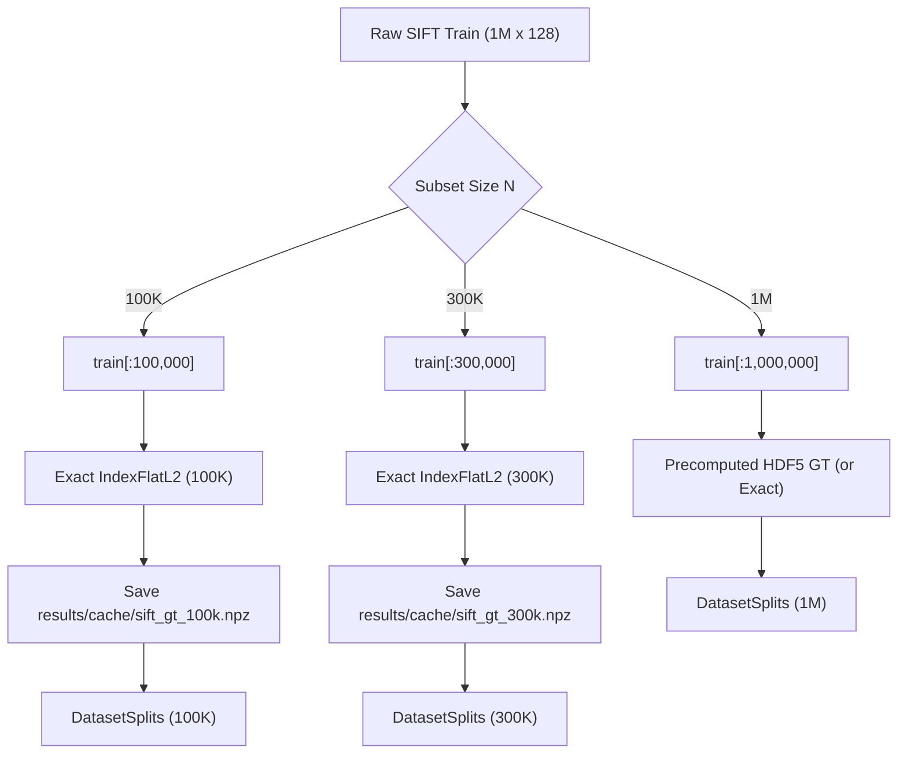

# Part 3 Implementation Plan: Scaling Experiment on SIFT

This plan outlines the design, methodology, parameter sweep settings, ground-truth computation, benchmarking pipeline, plotting, and verification for **Part 3: Scaling Experiment** of `Assignment 3 Benchmarking Approximate Nearest Neighbour Search.md`.

---

## 1. Goal Description

Evaluate how the cost of achieving **Recall@10 = 0.95** scales as the SIFT-128 database size increases across three scales:
$$N \in \{100\text{K}, 300\text{K}, 1\text{M}\} \quad (100,000, \; 300,000, \; 1,000,000 \text{ vectors})$$

The benchmark evaluates three index types specified in the assignment:
1. **Exact-Flat** (Brute-force baseline, reference recall = 1.000)
2. **HNSW** (`IndexHNSWFlat`)
3. **IVF-Flat** (`IndexIVFFlat`)

> [!IMPORTANT]
> **Independent Scientific Investigation**:
> As instructed by the user, our objective is **NOT** to force-validate the hypothesis recorded in [`hypothesis.md`](file:///home/shrawani/Desktop/sem5/Information%20Retrieval%20and%20Extraction/ire_a3/hypothesis.md). The empirical data may confirm, partially confirm, or contradict the hypothesis; we will record and report the true measured behavior with objective architectural analysis.

---

## 2. Proper Ground-Truth Computation for Subsets

> [!WARNING]
> **Critical Methodological Requirement**:
> The precomputed `neighbors` and `distances` in `sift-128-euclidean.hdf5` are valid **only for the full 1,000,000 vector database**.
> For any subset ($N=100\text{K}$ or $N=300\text{K}$):
> - The true nearest neighbours within `train[:N]` are different from those in the 1M dataset (some 1M top-10 vectors do not exist in the subset, and vectors ranked #15–#50 in 1M become top-10 in the subset).
> - Using the 1M ground truth for subsets would falsely depress recall and reference non-existent vector IDs ($> N$).

### Ground Truth Solution:
We will implement an exact ground-truth generator function `compute_ground_truth()`:
- Built using FAISS `IndexFlatL2` on `train[:N]`.
- Batch exact search across all 10,000 queries ($k=100$).
- Ground truth distances aligned to Euclidean metric ($\sqrt{\max(D, 0)}$).
- Both `neighbors` and `distances` are partitioned into the standard query splits:
  - Tuning split: queries `0:5000`
  - Evaluation split: queries `5000:10000`
- Cached to `results/cache/sift_gt_100k.npz` and `results/cache/sift_gt_300k.npz` to eliminate redundant recalculation across test and benchmark runs.



---

## 3. Parameter Settings & Sweeps

All queries are timed **one query at a time on 1 CPU thread** (`faiss.omp_set_num_threads(1)`), taking the **median over runs after warmup**, evaluated on queries `5000:10000`.

### A. Exact-Flat
- No hyperparameter.
- Measures single-query latency, throughput (QPS), build time (memory copy), and memory footprint ($N \times 128 \times 4$ bytes) at recall = 1.000.

### B. HNSW (`IndexHNSWFlat`)
- **Build parameters**:
  - $M \in \{8, 16, 32\}$ (vertex connectivity degree)
  - $\text{efConstruction} = 64$
- **Search sweep**:
  - $\text{efSearch} \in \{8, 16, 32, 64, 128, 256, 512\}$
- Spans recall from $\sim 0.55$ up to $> 0.99$.
- Evaluates whether higher $N$ requires larger $\text{efSearch}$ or higher $M$ to maintain Recall@10 $\ge 0.95$.

### C. IVF-Flat (`IndexIVFFlat`)
- **Build parameters ($\text{nlist}$)**:
  - Inverted file partitioning balances cluster count and average list length $L = N / \text{nlist}$.
  - We sweep $\text{nlist}$ settings tailored to each scale:
    - **100K**: $\text{nlist} \in \{512, 1024, 2048\}$ (average list lengths: 195, 98, 49)
    - **300K**: $\text{nlist} \in \{512, 1024, 2048\}$ (average list lengths: 586, 293, 146)
    - **1M**: $\text{nlist} \in \{1024, 2048, 4096\}$ (average list lengths: 976, 488, 244 — matches Part 2)
  - Notice that $\text{nlist}=1024$ and $\text{nlist}=2048$ are tested across **all three scales**, enabling both:
    1. A fixed-architecture comparison ($\text{nlist}=1024$, showing how list length growth degrades speed).
    2. A scaled-architecture comparison ($\text{nlist} \approx \sqrt{N}$, optimal tuning per scale).
- **Search sweep ($\text{nprobe}$)**:
  - $\text{nprobe} \in \{1, 2, 4, 8, 16, 32, 64, 128, 256\}$
  - Spans recall from $\sim 0.30$ to $1.0000$.

---

## 4. Proposed Changes

### Component 1: Ground-Truth & Data Handling Layer
#### [MODIFY] [`src/data.py`](file:///home/shrawani/Desktop/sem5/Information%20Retrieval%20and%20Extraction/ire_a3/src/data.py)
- Implement `compute_ground_truth(train_vectors, queries, k=100, metric="euclidean") -> Tuple[np.ndarray, np.ndarray]`.
- Update `load_dataset` with a `compute_gt_if_subset: bool = True` option and caching mechanism (`results/cache/sift_gt_{N}.npz`), ensuring ground truths for subsets are strictly accurate.

#### [MODIFY] [`src/config.py`](file:///home/shrawani/Desktop/sem5/Information%20Retrieval%20and%20Extraction/ire_a3/src/config.py)
- Define `PART3_SCALING_SIZES = [100_000, 300_000, 1_000_000]`.
- Define `PART3_FIGURES_DIR = FIGURES_DIR / "part3"`.
- Define `PART3_CACHE_DIR = RESULTS_DIR / "cache"`.
- Define scaling sweep grids for 100K, 300K, and 1M.

---

### Component 2: Plotting & Scaling Analysis
#### [MODIFY] [`src/benchmark/plotting.py`](file:///home/shrawani/Desktop/sem5/Information%20Retrieval%20and%20Extraction/ire_a3/src/benchmark/plotting.py)
- Add functions to generate Part 3 scaling figures:
  1. `plot_scaling_metric_vs_size(scaling_data, metric_name, ylabel, output_path, log_x=True, log_y=True)`:
     - Generates publication-ready scaling plots:
       - **QPS at Recall 0.95 vs. $N$**
       - **Latency (ms) at Recall 0.95 vs. $N$**
       - **Build Time (s) at Recall 0.95 vs. $N$**
       - **Index Size (MB) at Recall 0.95 vs. $N$**
  2. Generates trade-off curves for $N=100\text{K}$ and $N=300\text{K}$ with exact baselines (`sift_100k_recall_vs_qps.png`, `sift_300k_recall_vs_qps.png`).

---

### Component 3: CLI Runner Script
#### [NEW] [`scripts/run_part3.py`](file:///home/shrawani/Desktop/sem5/Information%20Retrieval%20and%20Extraction/ire_a3/scripts/run_part3.py)
- Command-line runner for Part 3:
  ```bash
  python scripts/run_part3.py --sizes 100000 300000 1000000 --num-runs 2
  ```
- Workflow:
  1. Ensures ground truth for 100K and 300K is computed and cached.
  2. Runs Exact-Flat on 100K and 300K (1M can be reused from Part 2 or recomputed with `--rerun-1m`).
  3. Benchmarks HNSW and IVF-Flat sweeps on 100K and 300K.
  4. Computes Pareto frontiers and interpolates QPS / Latency at Recall@10 = 0.95.
  5. Records all rows to `results/results.csv`.
  6. Generates scaling plots in `results/figures/part3/`.
  7. Formats and prints the final scaling comparison table to the terminal.
  8. Supports `--quick` flag for rapid verification.

---

### Component 4: Test Suite
#### [NEW] [`tests/test_part3_scaling.py`](file:///home/shrawani/Desktop/sem5/Information%20Retrieval%20and%20Extraction/ire_a3/tests/test_part3_scaling.py)
- Unit tests:
  - `test_compute_ground_truth_synthetic`: verifies exact nearest neighbour ranking and distance calculation on known synthetic data.
  - `test_compute_ground_truth_sift_agreement`: verifies that running `compute_ground_truth` on the full 1M SIFT sample produces 100% agreement with the HDF5 stored ground truth.
  - `test_subset_ground_truth_id_bounds`: verifies that for subset $N$, all nearest neighbour IDs are strictly $< N$.
  - `test_scaling_interpolation`: tests extraction of metrics at recall 0.95 across multiple scales.

---

### Component 5: Documentation & Reporting
#### [MODIFY] [`README.md`](file:///home/shrawani/Desktop/sem5/Information%20Retrieval%20and%20Extraction/ire_a3/README.md)
- Add **Part 3: Scaling Experiment (SIFT 100K, 300K, 1M)** section:
  - Table of QPS, Latency, Build Time, Index Size, and Speedup vs Exact at Recall 0.95 across 100K, 300K, 1M.
  - Embedded scaling figures (`part3_scaling_qps.png`, `part3_scaling_latency.png`, `part3_scaling_build_time.png`).
  - Discussion analyzing the empirical scaling trends vs. the hypothesis in `hypothesis.md`.
  - Instructions to run Part 3 benchmarks.

---

## 5. Verification Plan

### Automated Tests
```bash
pytest tests/ -v
```
Verifies all existing 17 tests plus new Part 3 tests.

### Ground-Truth Sanity Verification
Run sanity check comparing full 1M computed ground truth against HDF5 stored ground truth:
```bash
python -c "from src.data import load_dataset, compute_ground_truth; ..."
```

### Quick Mode Verification
```bash
python scripts/run_part3.py --sizes 100000 --quick
```
Runs a rapid end-to-end check in under 30 seconds.

### Full Scaling Experiment Execution
```bash
python scripts/run_part3.py --sizes 100000 300000 1000000 --num-runs 2
```
Generates all Part 3 rows in `results/results.csv` and figures in `results/figures/part3/`.

---

## 6. User Review Required

> [!IMPORTANT]
> **Reuse vs. Re-run for 1M SIFT**:
> In Part 2, we already executed the complete single-threaded benchmark on 1M SIFT for Exact-Flat, HNSW ($M=8, 16, 32$), and IVF-Flat ($\text{nlist}=1024, 2048, 4096$) with queries 5000–10000.
> **Proposed Strategy**:
> `scripts/run_part3.py` will read the 1M SIFT numbers directly from `results/results.csv` if available (guaranteeing exact consistency with Part 2 and saving $\approx 6$ minutes), while providing a `--rerun-1m` command-line flag if the user explicitly wants to re-execute 1M from scratch.
> 
> Please let me know if you would like any adjustments to this plan before proceeding.
