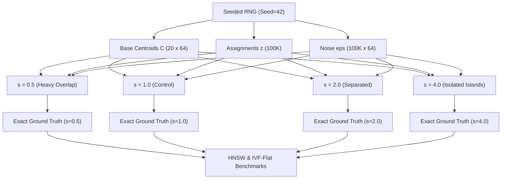

# Part 4 Implementation Plan: Hard Geometry (Cluster Separation) Experiment

This plan outlines the architecture, data generation, benchmarking, evaluation, and plotting pipeline for **Part 4: Experiment on your own data** of `Assignment 3 Benchmarking Approximate Nearest Neighbour Search.md`.

---

## 1. Goal Description

Investigate how **cluster separation and overlap** in high-dimensional space affect the search effort and throughput required by **HNSW** and **IVF-Flat** to achieve **Recall@10 $\ge$ 0.95**.

### Key Problem & Motivation
Standard ANN benchmarks evaluate data with fixed, uncharacterized geometry. In this experiment:
- We control the geometric structure directly by generating synthetic datasets in $D=64$ dimensions across $K=20$ Gaussian clusters.
- We vary the **cluster separation multiplier** across four settings:
  $$s \in \{0.5, \; 1.0, \; 2.0, \; 4.0\}$$
  where $s = 1.0$ serves as the unchanged **control**.
- Crucially, **we reuse the exact same cluster centers, cluster assignments, and Gaussian noise vectors across all settings** so that the *only* property changing between datasets is the spatial distance between clusters.
- Total database vectors generated: $100\text{K} \times 4 = 400\text{K}$ vectors (strictly adhering to the assignment's $\le 500\text{K}$ ceiling).

---

## 2. Mathematical Formulation of the Data Generator

Let:
- $D = 64$ (vector dimension)
- $K = 20$ (number of Gaussian clusters)
- $N = 100,000$ (number of database vectors per setting)
- $Q = 2,000$ (1,000 tuning queries, 1,000 evaluation queries)
- Seed: $\text{seed} = 42$ (seeded generator for exact reproducibility)

### Generation Procedure:
1. **Base Cluster Centroids**:
   $$C_k \sim \mathcal{N}(0, I_D), \quad k \in \{0, \dots, K-1\}$$
   Normalized to unit norm and scaled by a baseline radius $R = 3\sqrt{D}$.
2. **Cluster Assignments**:
   $$z_i \in \{0, \dots, K-1\} \quad \text{for } i \in \{0, \dots, N-1\}$$
   Generated once and reused for all separation settings.
3. **Within-Cluster Gaussian Noise**:
   $$\epsilon_i \sim \mathcal{N}(0, \sigma^2 I_D), \quad \sigma = 1.0$$
   Generated once and reused for all separation settings.
4. **Database Vectors for Setting $s$**:
   $$X_i^{(s)} = s \cdot C_{z_i} + \epsilon_i, \quad s \in \{0.5, 1.0, 2.0, 4.0\}$$
5. **Query Vectors for Setting $s$**:
   $$Q_j^{(s)} = s \cdot C_{z_j^{\text{query}}} + \epsilon_j^{\text{query}}$$
6. **Separate Exact Ground Truth per Setting**:
   For each $s \in \{0.5, 1.0, 2.0, 4.0\}$, compute exact top-100 nearest neighbours and Euclidean distances using FAISS `IndexFlatL2` on $(X^{(s)}, Q^{(s)})$.



---

## 3. Experimental Setup & Parameter Sweeps

### Fixed Index Build Parameters
As required by the assignment ("change one thing at a time... fixed build parameters"):
- **HNSW** (`IndexHNSWFlat`):
  - Fixed $M = 16$
  - Fixed $\text{efConstruction} = 64$
- **IVF-Flat** (`IndexIVFFlat`):
  - Fixed $\text{nlist} = 512$ (standard Voronoi partitioning for 100K vectors)

### Runtime Search Parameter Sweeps
- **HNSW**: Sweep $\text{efSearch} \in \{4, 8, 16, 32, 64, 128, 256, 512\}$
- **IVF-Flat**: Sweep $\text{nprobe} \in \{1, 2, 4, 8, 16, 32, 64, 128, 256\}$
- **Exact-Flat**: Single-query baseline on 1 CPU thread for each setting $s$.

### Ground Rules & Measurement
- Execution on **1 CPU thread** (`faiss.omp_set_num_threads(1)`).
- Single query at a time, median of runs after warmup.
- Evaluated on queries 1,000–2,000 (1,000 evaluation queries).
- Distance-threshold `recall@10` ($\text{candidate distance} \le d_{10} + 10^{-4}$).
- All results logged into `results/results.csv`.

---

## 4. Proposed Changes

### Component 1: Data Generator Layer
#### [NEW] [`src/data_generator.py`](file:///home/shrawani/Desktop/sem5/Information%20Retrieval%20and%20Extraction/ire_a3/src/data_generator.py)
- `generate_clustered_dataset()`:
  - Generates base centroids, cluster assignments, and Gaussian noise.
  - Generates $X^{(s)}$ and $Q^{(s)}$ for each separation $s$.
  - Computes exact ground truth using `IndexFlatL2`.
  - Caches generated arrays to `results/cache/synthetic_sep_{s}.npz` for instant reload.

---

### Component 2: Configuration
#### [MODIFY] [`src/config.py`](file:///home/shrawani/Desktop/sem5/Information%20Retrieval%20and%20Extraction/ire_a3/src/config.py)
- Define Part 4 constants:
  ```python
  PART4_DIM = 64
  PART4_N_CLUSTERS = 20
  PART4_N_VECTORS = 100_000
  PART4_N_QUERIES = 2_000
  PART4_SEPARATIONS = [0.5, 1.0, 2.0, 4.0]
  PART4_CONTROL_SEPARATION = 1.0
  PART4_SEED = 42
  PART4_HNSW_M = 16
  PART4_HNSW_EF_CONSTRUCTION = 64
  PART4_IVF_NLIST = 512
  PART4_FIGURES_DIR = FIGURES_DIR / "part4"
  ```

---

### Component 3: Plotting & Visualization
#### [MODIFY] [`src/benchmark/plotting.py`](file:///home/shrawani/Desktop/sem5/Information%20Retrieval%20and%20Extraction/ire_a3/src/benchmark/plotting.py)
- Implement `plot_part4_hard_geometry()`:
  - Generates the **Main 4-Panel Figure** for the report:
    - **Panel A**: IVF-Flat Recall@10 vs. QPS across all 4 separation settings.
    - **Panel B**: HNSW Recall@10 vs. QPS across all 4 separation settings.
    - **Panel C**: Required Search Effort ($\text{nprobe}$ / $\text{efSearch}$) to reach Recall $\ge 0.95$ vs. Separation Multiplier $s$.
    - **Panel D**: Single-query QPS at Recall $\ge 0.95$ vs. Separation Multiplier $s$.
  - Saves main figure to `results/figures/part4/part4_hard_geometry_main.png`.
  - Also outputs standalone sub-figures for documentation.

---

### Component 4: CLI Benchmark Runner
#### [NEW] [`scripts/run_part4.py`](file:///home/shrawani/Desktop/sem5/Information%20Retrieval%20and%20Extraction/ire_a3/scripts/run_part4.py)
- Standalone CLI runner:
  ```bash
  python scripts/run_part4.py --separations 0.5 1.0 2.0 4.0 --num-runs 2
  ```
- Workflow:
  1. Generates or loads cached synthetic datasets and ground truths for each separation.
  2. Benchmarks Exact-Flat, HNSW, and IVF-Flat.
  3. Interpolates QPS and finds the search parameter ($\text{efSearch}$ / $\text{nprobe}$) required to achieve Recall@10 $\ge 0.95$.
  4. Logs all runs to `results/results.csv`.
  5. Generates the 4-panel main figure and trade-off curves in `results/figures/part4/`.
  6. Prints the summary table to the terminal.
  7. Supports `--quick` mode for laptop execution in under 2 minutes.

---

### Component 5: Unit & Integration Tests
#### [NEW] [`tests/test_part4_synthetic.py`](file:///home/shrawani/Desktop/sem5/Information%20Retrieval%20and%20Extraction/ire_a3/tests/test_part4_synthetic.py)
- `test_data_generator_determinism`: Verifies same seed yields identical arrays.
- `test_noise_and_assignment_reuse`: Asserts $X^{(2.0)} - 2.0 \cdot C_z == X^{(1.0)} - 1.0 \cdot C_z == \epsilon$.
- `test_ground_truth_accuracy`: Asserts ExactFlatIndex achieves 100% recall against computed ground truth.
- `test_synthetic_ann_search`: Smoke tests HNSW and IVF-Flat on small synthetic sample.

---

### Component 6: Documentation & Reporting
#### [MODIFY] [`README.md`](file:///home/shrawani/Desktop/sem5/Information%20Retrieval%20and%20Extraction/ire_a3/README.md)
- Add **Part 4: Experiment on Your Own Data — Hard Geometry (Cluster Separation)** section:
  - Experimental design and generator specification.
  - Summary table of search effort and QPS at Recall $\ge 0.95$ across separations $0.5, 1.0, 2.0, 4.0$.
  - Embedded main figure: `results/figures/part4/part4_hard_geometry_main.png`.
  - Detailed scientific analysis: physical mechanisms of cluster overlap on inverted lists vs. graph routing, hypothesis evaluation, and what was not tested.
  - Reproduction commands.

---

## 5. Verification Plan

### Automated Tests
```bash
pytest tests/ -v
```
All 19 existing tests + new Part 4 tests must pass.

### Quick Mode Verification
```bash
python scripts/run_part4.py --quick
```
Runs on 10K vectors with reduced sweeps in under 2 minutes to verify the end-to-end pipeline.

### Full Benchmark Execution
```bash
python scripts/run_part4.py --separations 0.5 1.0 2.0 4.0 --num-runs 2
```
Generates all 400K vector benchmarks, logs to `results/results.csv`, and writes figures to `results/figures/part4/`.

---

## 6. User Review Required

> [!IMPORTANT]
> **Total Vector Budget & Reproducibility**:
> - 4 settings $\times$ 100K vectors = 400K database vectors generated (within the assignment's 500K ceiling).
> - Base centroids, assignments, and noise are strictly preserved across settings so that separation is the sole independent variable.
> - Fixed build parameters: HNSW ($M=16, \text{efConstruction}=64$), IVF-Flat ($\text{nlist}=512$).
> 
> Please review and approve the plan to proceed with execution.
